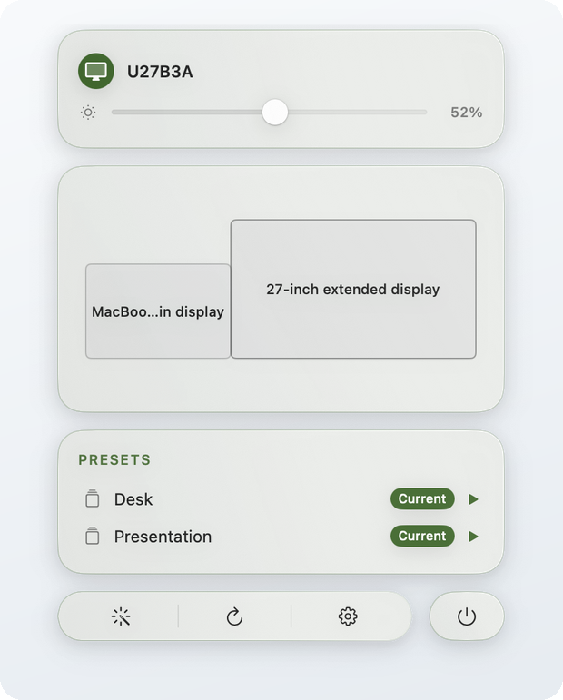
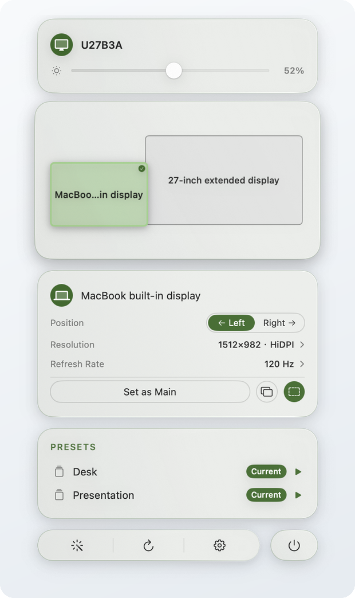
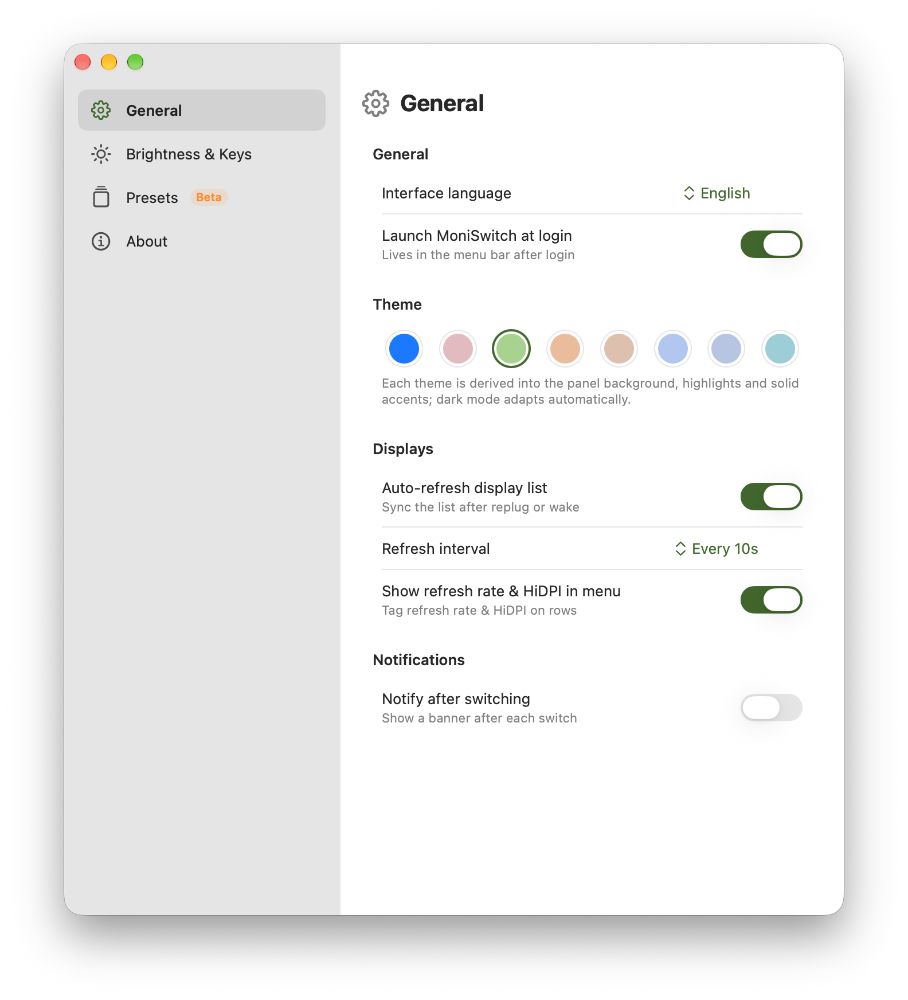
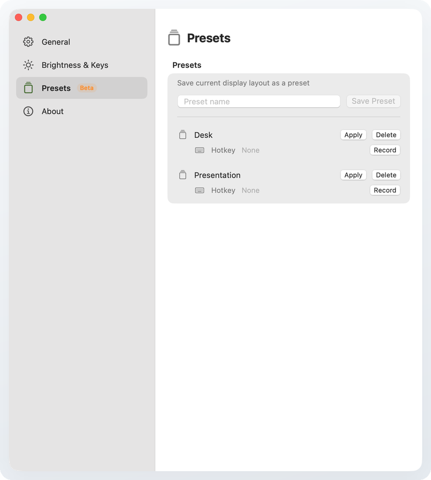
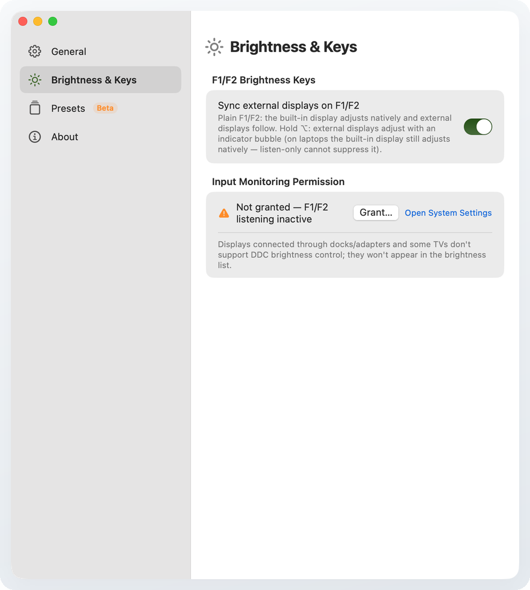
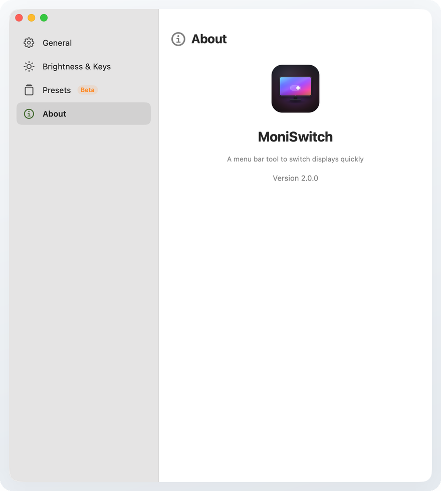

<p align="center">
  <a href="docs/poster.svg?v=2">
    
  </a>
</p>

<div align="center">

# MoniSwitch

**A menu-bar control center for every display on your Mac.**

Switch the main screen, arrange mirrors, restore whole layouts, and dim external displays — native DDC/CI, F1/F2 keys, no background helper.

[English](README.md) · [简体中文](README.zh-CN.md) · [Website](https://m1688-cpu.github.io/MoniSwitch/)

<p align="center">
  <a href="https://github.com/M1688-cpu/MoniSwitch/releases/latest"></a>
  <a href="https://github.com/M1688-cpu/MoniSwitch#requirements"></a>
  <a href="https://github.com/M1688-cpu/MoniSwitch#requirements"></a>
  <a href="LICENSE"></a>
</p>

<a href="https://github.com/M1688-cpu/MoniSwitch/releases/latest/download/MoniSwitch.dmg"></a>

[Features](#features) · [Screenshots](#screenshots) · [Install](#install) · [Usage](#usage) · [FAQ](#faq)

</div>

---

MoniSwitch lives in the menu bar and opens a floating bubble-card panel, not a system menu. Every display is drawn to scale, every switch is one or two clicks away, and the panel resizes itself around what you open — no inner scroll area, no digging through System Settings → Displays.

**v2.0 is a ground-up rewrite of the panel** and adds the other half of owning a monitor: external-display brightness. Each DDC/CI-capable screen gets a slider at the top of the panel, the F1/F2 brightness keys adjust the display under the pointer, and seven low-saturation themes recolor the whole panel in light and dark mode.

## What's new in v2.0

- **External brightness, natively.** A DDC/CI slider per external display, implemented on Apple Silicon through the private `IOAVService` I2C path — the same route MonitorControl and m1ddc use. No kernel extension, no background DDC helper, no `ddcctl`.
- **F1/F2 follows you.** An active `CGEventTap` watches the brightness keys and adjusts the DDC brightness of the display under the pointer; the built-in screen and non-DDC screens keep their native response. Hold `⌥` to adjust every external screen at once, with a small HUD.
- **A new panel, not a reskin.** The old `NSPopover` is gone. MoniSwitch now owns a borderless `NSPanel`: the panel is anchored under the menu-bar icon, fades and scales in from the top, and dismisses on any outside click.
- **Control-Center layout.** Brightness is pinned at the top, the to-scale layout preview is the hub, and clicking a display block unfolds that screen's parameters in a second bubble card. Presets and the bottom toolbar follow.
- **Seven themes + follow system.** Sage, rose, orange, brown, blue, blue-grey and cyan-grey — each derived into a card background, a highlight and a solid accent, with separate light and dark derivations.
- **A rebuilt Settings window.** Native sidebar material, grouped cards, and a new **Brightness & Keys** tab for the F1/F2 listener, its Accessibility permission and DDC compatibility notes.

## Features

| Area | What you get |
| --- | --- |
| **Displays** | Pick the main display, place externals left/right, extend or mirror, auto-arrange side by side, and switch resolution or refresh rate. |
| **Brightness** | Native DDC/CI sliders for external screens, F1/F2 for the display under the pointer, a compact HUD, and per-display values remembered by EDID identity. |
| **Presets** | Save the whole layout — main screen, positions, mirroring — and restore it in one click or with a global hotkey. |
| **Panel** | A borderless floating panel with a to-scale layout map, collapsible parameter groups, spring animations and hover lift. |
| **Settings** | Bilingual UI (English / 简体中文), launch at login, auto-refresh, notifications, themes, presets and permissions. |

### Every display, one click

- **Click a block, control that screen.** The layout preview is the hub. Clicking a display block expands its parameter bubble; clicking it again collapses it. Only one screen is open at a time, so the panel never jumps around.
- **Set as Main** moves the menu bar and Dock to the screen you choose, keeping the left/right relationship of the other displays.
- **Position** is a segmented left/right control; **Resolution** and **Refresh Rate** open in-place option lists. HiDPI variants are tagged, and picking a resolution no longer drops a 4K screen into a non-scaled mode.
- **Mirror or extend** with two icon buttons on non-main displays. The mirror target is named, and tooltips spell out what each button will do.
- **Auto-arrange** lays every screen out side by side, removes overlaps, and keeps mirror groups intact.
- **Presets** save a complete configuration. A preset that matches the current layout gets a **Current** badge; matching compares resolution, refresh rate, position and mirror state rather than volatile screen IDs. If persistent IDs change after a replug, MoniSwitch remaps the preset by resolution and screen count instead of failing silently.
- **Global hotkeys** bind one Carbon `RegisterEventHotKey` shortcut per preset — no Accessibility permission required.

### Brightness that follows you

- **Native DDC/CI on Apple Silicon.** The DDC stack speaks the monitor's I2C control channel directly through the private `IOAVService` API, resolved at runtime with `dlopen`/`dlsym` and degrading gracefully if a symbol is missing.
- **One slider per external screen.** MoniSwitch discovers DDC-capable externals, maps `CGDirectDisplayID` to the matching `IOAVService`, and remembers each screen's value by EDID UUID, so unplugging and replugging does not reset your brightness.
- **F1/F2 targets the pointer.** Bare F1/F2 adjusts the DDC screen under the mouse; MoniSwitch consumes the key only for a controllable external display. Anywhere else the event passes through, so the built-in screen keeps its native OSD. Hold `⌥` while pressing F1/F2 to adjust every external screen at once.
- **The HUD stays out of the way.** A small bubble sits under the menu-bar icon, renews while you hold the key, and fades after 1.2 seconds.
- **DDC compatibility is explained in Settings.** Displays connected through some docks, adapters or TVs do not expose DDC brightness; they simply do not appear in the brightness list. The app tells you this instead of showing a dead slider.

### A panel that behaves like a native menu

- The panel is a **borderless `NSPanel`** owned by MoniSwitch, anchored directly under the menu-bar icon. It fades in while scaling from the top, and dismisses on any click outside — including clicks on other menu-bar extras.
- **Height follows content.** There is no panel-level `ScrollView`; opening a parameter group or switching language grows the panel with a spring animation instead of producing a scrollbar.
- **Hover has weight.** Cards lift slightly with a 2D affine scale anchored at the bottom edge, so the pointer can never fall into a hover/reset oscillation. Buttons in the bottom toolbar bulge locally on hover.
- **Long operations are visible.** A flowing progress bar appears while a switch is in flight, and the panel refuses double-triggers. Failed switches raise a system notification.
- **The layout map is live.** Displays are drawn to scale; hovering a display row highlights its block, and the selected block carries a check mark.
- **Bilingual by design.** English and 简体中文 switch in one click, and the choice persists. By default the panel follows the system accent color; seven built-in themes can replace it.

### Settings without the clutter

- **General** — interface language, launch at login, theme, auto-refresh (with interval), detailed menu tags, and post-switch notifications.
- **Brightness & Keys** — enable or disable the F1/F2 listener, see the Accessibility state, jump to System Settings, and read the DDC compatibility note.
- **Presets** — save the current layout, apply or delete a preset, record a global hotkey, or clear it.
- **About** — app icon, version and one-line description.

## Screenshots

> The interface switches between English and 简体中文 in one click. These screenshots use the English UI; the [Chinese README](README.zh-CN.md) has the matching 简体中文 set.

<table>
  <tr>
    <td width="50%" align="center" valign="middle">
      
      <br><b>Panel overview</b>
      <br><sub>Brightness pinned at the top, a to-scale layout hub, presets and the bottom toolbar.</sub>
    </td>
    <td width="50%" align="center" valign="middle">
      
      <br><b>Display controls expanded</b>
      <br><sub>Click a display block to unfold position, resolution, refresh rate, Set as Main and mirror/extend.</sub>
    </td>
  </tr>
  <tr>
    <td width="50%" align="center" valign="top">
      
      <br><b>Settings · General</b>
      <br><sub>Language, launch at login, seven themes, refreshing and notifications in the native settings layout.</sub>
    </td>
    <td width="50%" align="center" valign="top">
      
      <br><b>Settings · Presets</b>
      <br><sub>Save the current layout, apply or delete a preset, and bind one global hotkey per preset.</sub>
    </td>
  </tr>
</table>

<details>
<summary><b>More screenshots</b> — Brightness &amp; Keys, About</summary>

<table>
  <tr>
    <td width="50%" align="center" valign="top">
      
      <br><b>Settings · Brightness &amp; Keys</b>
      <br><sub>The F1/F2 listener, the permission it needs and the DDC compatibility note live together. This capture shows the un-granted state; the app links straight to the permission.</sub>
    </td>
    <td width="50%" align="center" valign="top">
      
      <br><b>Settings · About</b>
      <br><sub>App icon, description and the current version.</sub>
    </td>
  </tr>
</table>

</details>

## Install

### Download the DMG

<p align="center">
  
  <br><sub>Open the DMG and drag MoniSwitch into Applications.</sub>
</p>

1. Download the latest [`MoniSwitch.dmg`](https://github.com/M1688-cpu/MoniSwitch/releases/latest/download/MoniSwitch.dmg) from Releases.
2. Open the DMG and drag **MoniSwitch** into **Applications**.
3. On first launch, macOS may say the app is from an unidentified developer. MoniSwitch is not Apple-notarized (see [the note below](#about-the-notarization-warning)); approve it once in **System Settings → Privacy & Security → Open Anyway**. You will not be asked again.

> [!TIP]
> The app is a pure menu-bar app: after launch it has no Dock icon and no main window. Look for the display icon in the menu bar — on a crowded menu bar, use ⌘-drag to move it where you can see it.

### Build from source

You need macOS 14 or later, Xcode / the Swift 6 toolchain, and the `displayplacer` binary. `displayplacer` is not committed to this repository; see [`Resources/README.md`](Resources/README.md).

```bash
# 1. Clone
git clone https://github.com/M1688-cpu/MoniSwitch.git
cd MoniSwitch

# 2. Place displayplacer (see Resources/README.md)
cp /path/to/displayplacer-apple-v140 ./Resources/displayplacer
chmod +x ./Resources/displayplacer

# 3. Build, bundle, sign and create the DMG in one shot
bash Support/build-app.sh

# Outputs:
#   Support/MoniSwitch.app
#   Support/MoniSwitch.dmg
```

Run the test suite with:

```bash
bash Support/run-tests.sh
```

The app is built with Swift Package Manager — there is no `.xcodeproj`. The packaging script auto-detects the newest available macOS SDK (Xcode's 27.0 SDK when installed, otherwise the newest Command Line Tools SDK).

## Usage

1. Launch MoniSwitch and click the display icon in the menu bar.
2. The panel shows a brightness card for every DDC-capable external display, a to-scale layout map, and your presets.
3. Click a display block to unfold its controls:
   - **Position** — put the display left or right of the main screen.
   - **Resolution / Refresh Rate** — click the row to open the option list; HiDPI variants are tagged.
   - **Set as Main** — move the menu bar and Dock to that display.
   - **Mirror / Extend** — use the two icon buttons on a non-main display; hover for a plain-language tooltip.
4. Use the top brightness sliders, or the F1/F2 keys — bare keys adjust the display under the pointer, `⌥` adjusts every external screen.
5. Click **Presets** to restore a saved layout. Presets matching the current layout carry a **Current** badge.
6. Click anywhere outside the panel to dismiss it. The gear button opens Settings; the power button quits the app.

## Requirements

- **macOS 14 Sonoma or later.**
- **Apple Silicon.** The current release is an arm64 build; Intel support is on the roadmap.
- **A DDC/CI-capable external display** for the brightness features. Many USB-C docks, adapters and TVs do not expose DDC brightness; those screens are skipped rather than shown with a dead slider.
- **Accessibility permission** for the F1/F2 listener (optional). Without it, the sliders and presets still work; only the brightness-key listener is inactive.

## Permissions and privacy

MoniSwitch does not use analytics, telemetry or a network service. Display changes run through the bundled `displayplacer` binary, brightness runs over the local DDC/CI channel, and presets/settings stay in your `UserDefaults`.

The only privacy permission it may ask for is **Accessibility**, used by the active F1/F2 `CGEventTap`. Post-switch notifications are off by default; if you turn them on, macOS will also ask for notification permission. The tap consumes the media-key event only when the pointer is over a DDC-controllable external display; anywhere else the event passes through. If you prefer not to grant it, turn the F1/F2 listener off in **Settings → Brightness & Keys**; everything else continues to work.

## About the notarization warning

MoniSwitch is distributed as a direct DMG rather than through the Mac App Store, so it carries no Apple notarization. This is common for open-source freeware, and the code is fully open for review. Approve it once via **System Settings → Privacy & Security → Open Anyway** and macOS will remember the choice.

## How it works

MoniSwitch is a SwiftUI + AppKit menu-bar app. The heavy lifting is split into three local pieces:

- **Arrangement** — a GUI over [displayplacer](https://github.com/jakehilborn/displayplacer) (MIT, © Jake Hilborn). Switching the main display moves the target screen's `origin` to `(0,0)` and shifts the others by the same vector; mirroring uses displayplacer's `id:A+B` syntax; auto-arrange lays screens out side by side while keeping mirror groups merged.
- **Brightness** — a native DDC/CI engine on Apple Silicon. The app resolves the private `IOAVService` symbols at runtime, discovers the matching service for each external display, and writes `[0x84, 0x03, 0x10, hi, lo, checksum]` packets through a serial `actor` with write coalescing and release guards. The protocol vectors and parser behavior are covered by tests.
- **Keys** — an active `CGEventTap` for F1/F2. It reads the media-key event, targets the display under the pointer, and writes DDC brightness for a controllable external screen; built-in and non-DDC screens receive the untouched event. The tap requires Accessibility rather than Input Monitoring.

The panel itself is a borderless `NSPanel` with `sizingOptions = []`, a SwiftUI root pinned to the top, and a height bridge that writes the content's measured height back to the window. That combination is what makes the panel grow and shrink without the content drifting vertically.

## Tech stack

- **Language:** Swift 6 (language mode v5), SwiftUI + AppKit
- **Minimum OS:** macOS 14
- **Build:** Swift Package Manager, plain `Package.swift`, no Xcode project
- **Tests:** Swift Testing (DDC protocol vectors, displayplacer parser fixtures, preset drift remapping, panel theme derivation)
- **Distribution:** non-sandboxed, local ad-hoc signing, direct DMG
- **Brightness:** private `IOAVService` via `dlopen`/`dlsym`, Apple Silicon; F1/F2 via an active `CGEventTap` (Accessibility)
- **Icons:** SVG source in `design/icon-web/`, exported to `Resources/AppIcon-source.png` and `AppIcon.icns`

## Project structure

```
MoniSwitch/
├── Package.swift                  # SPM manifest
├── Sources/MoniSwitch/
│   ├── MoniSwitchApp.swift        # @main entry (menu-bar icon + ⌘, command)
│   ├── PanelController.swift      # NSStatusItem + borderless NSPanel shell
│   ├── AppState.swift             # Display list + switching operations
│   ├── PanelView.swift            # Bubble-card panel (brightness, layout hub, presets, toolbar)
│   ├── PanelTheme.swift           # Seven three-tone themes + light/dark derivation
│   ├── Components.swift           # Shared cards, buttons, pills, hover/lighting modifiers
│   ├── BubbleMetrics.swift        # Design tokens (radii, fonts, spacing, shadows)
│   ├── Models.swift               # Display, resolution, hotkey and preset models
│   ├── ShellRunner.swift          # displayplacer invocation wrapper
│   ├── DisplayManager.swift       # Parsing, switching, mirror groups, auto-arrange, drift remap
│   ├── AppSettings.swift          # Preferences (launch at login, refresh, notifications, themes)
│   ├── PresetManager.swift        # Layout presets (save / apply / delete / hotkey)
│   ├── HotkeyManager.swift        # Carbon RegisterEventHotKey
│   ├── DockPolicyManager.swift    # Settings window host
│   ├── SettingsView.swift         # Settings shell (sidebar + native materials)
│   ├── SettingsTabs.swift         # General / Brightness & Keys / Presets / About
│   ├── Localization.swift         # Bilingual strings (L10n + TextKey)
│   ├── PrivateAPI.swift           # dlopen/dlsym bridge for IOAVService + CoreDisplay
│   ├── DDC.swift                  # DDC/CI packet construction, checksum and reply parsing
│   ├── DDCDiscovery.swift         # External display → IOAVService mapping
│   ├── DDCWriter.swift            # Serial DDC I/O actor, coalescing and lifecycle guards
│   ├── BrightnessManager.swift    # Brightness hub (discovery, persistence, sliders, steps)
│   ├── BrightnessKeyTap.swift     # Active F1/F2 CGEventTap (pointer display)
│   └── BrightnessHUD.swift        # Mini brightness bubble under the menu-bar icon
├── Tests/MoniSwitchTests/         # Swift Testing suites
├── Resources/                     # Bundled displayplacer, AppIcon.icns, icon source
├── Support/                       # Info.plist, build-app.sh, run-tests.sh
├── design/icon-web/               # Icon SVG, preview page and PNG exports
├── docs/poster.svg                # README hero poster (SVG source)
├── screenshots/                   # README screenshots (en/zh pairs, same filenames)
├── README.md                      # This file (English)
├── README.zh-CN.md                # Simplified Chinese README
└── GITHUB_GUIDE.md                # Maintainer's GitHub handbook
```

## Roadmap

- [x] Display list and main-display switching
- [x] Move external screens left/right
- [x] Extend / mirror toggle
- [x] Bilingual UI (English / 简体中文)
- [x] Launch at login, auto-refresh, notifications
- [x] Layout presets and per-preset global hotkeys
- [x] In-panel resolution and refresh-rate switching
- [x] HiDPI-safe resolution switching
- [x] To-scale interactive layout preview
- [x] One-click auto-arrange with mirror-group awareness
- [x] Preset ID-drift remapping and **Current** badge
- [x] Borderless floating panel with spring reveal and outside-click dismissal
- [x] **v2:** native DDC/CI external brightness, F1/F2 listener and HUD
- [x] **v2:** seven themes with light/dark derivation
- [x] **v2:** rebuilt Settings window with a Brightness & Keys tab
- [ ] Intel support
- [ ] More than two displays — polish and testing
- [ ] Apple notarization

## FAQ

<details>
<summary><b>Does MoniSwitch support Intel Macs?</b></summary>

Not yet. The current build is Apple Silicon (arm64). Intel support is on the roadmap; the DDC discovery path is the part that needs additional work.
</details>

<details>
<summary><b>Why does macOS warn about an unidentified developer?</b></summary>

The app is distributed directly, not through the Mac App Store, and is not notarized by Apple. The code is open source. Approve it once in **System Settings → Privacy & Security → Open Anyway**. See [the note above](#about-the-notarization-warning).
</details>

<details>
<summary><b>Why doesn't my external display appear in the brightness list?</b></summary>

DDC/CI has to reach the monitor. Many USB-C docks, adapters, KVM switches and TVs do not pass the DDC channel through; those screens are skipped rather than shown with a slider that cannot work. Try a direct cable or a different port/adapter. The Settings window explains this in the Brightness & Keys tab.
</details>

<details>
<summary><b>Do I need to install displayplacer separately?</b></summary>

No. The released app bundles `displayplacer`. You only need to provide it when building from source; see [`Resources/README.md`](Resources/README.md).
</details>

<details>
<summary><b>Will F1/F2 still change my built-in display?</b></summary>

When the pointer is over a controllable external display, MoniSwitch consumes F1/F2 and drives that screen's DDC brightness. Anywhere else the event passes through, so the built-in display keeps its native response. Hold `⌥` while pressing F1/F2 to adjust every external display at once.
</details>

<details>
<summary><b>Do presets survive a replug?</b></summary>

Usually. If macOS changes a display's persistent ID, MoniSwitch remaps the saved arguments by resolution and screen count. If a complete, unambiguous mapping is not possible, the preset is left untouched rather than applied to the wrong screen.
</details>

<details>
<summary><b>Does the app phone home?</b></summary>

No. There is no analytics, telemetry or account. Display and brightness work locally; presets and preferences live in `UserDefaults`.
</details>

## Contributing

Bug reports and pull requests are welcome. If you change the UI, re-capture the affected `screenshots/en` and `screenshots/zh` images so both READMEs stay in sync. Before opening a PR, run:

```bash
bash Support/run-tests.sh
bash Support/build-app.sh
```

## License

MIT License. The MoniSwitch code is © the MoniSwitch contributors.
The bundled [displayplacer](https://github.com/jakehilborn/displayplacer) is © Jake Hilborn and also MIT-licensed.

## Acknowledgements

- [displayplacer](https://github.com/jakehilborn/displayplacer) — the display-configuration engine behind the arrangement features.
- [MonitorControl](https://github.com/MonitorControl/MonitorControl) and [m1ddc](https://github.com/waydabber/m1ddc) — both MIT; their DDC/CI constants, checksums and display→service mapping informed the brightness engine. MoniSwitch is an independent implementation, not a fork.
- The icon's aurora palette and the panel's three-tone themes were designed in-house; the SVG sources live in [`design/icon-web/`](design/icon-web/) and [`docs/poster.svg`](docs/poster.svg).
