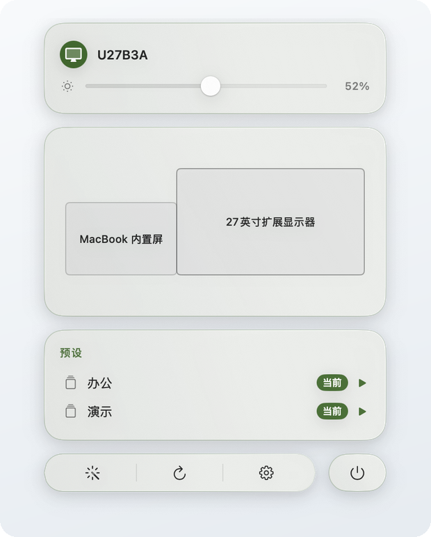
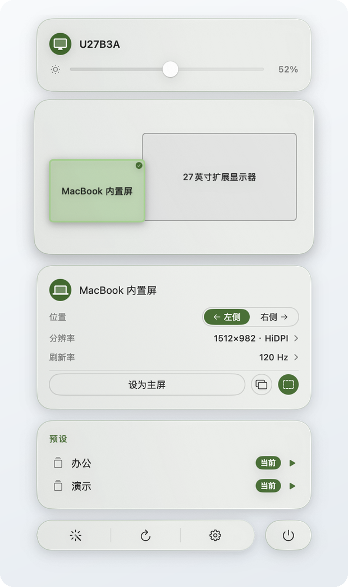
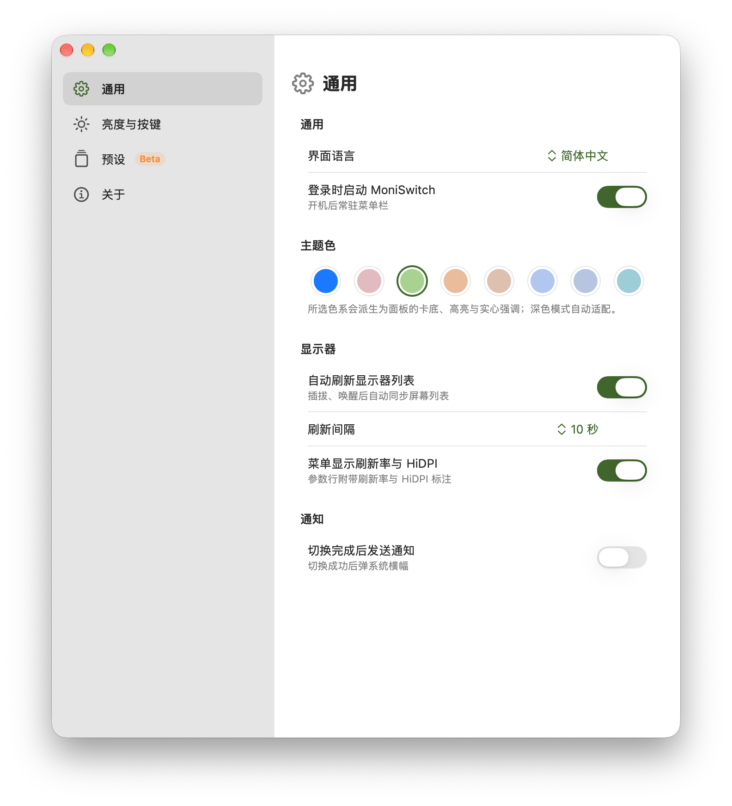
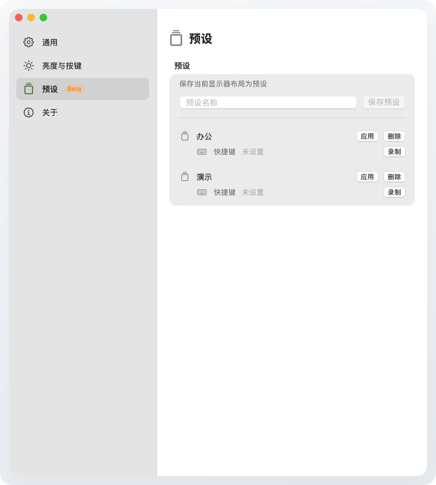
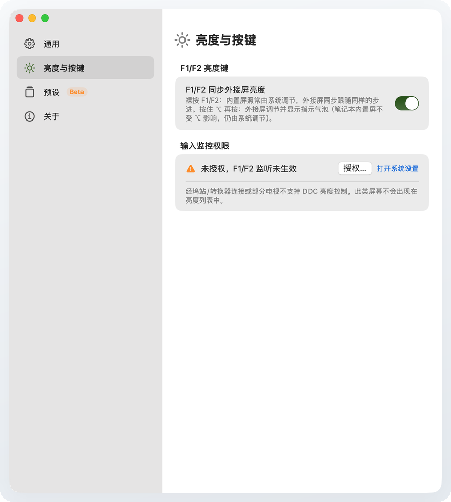
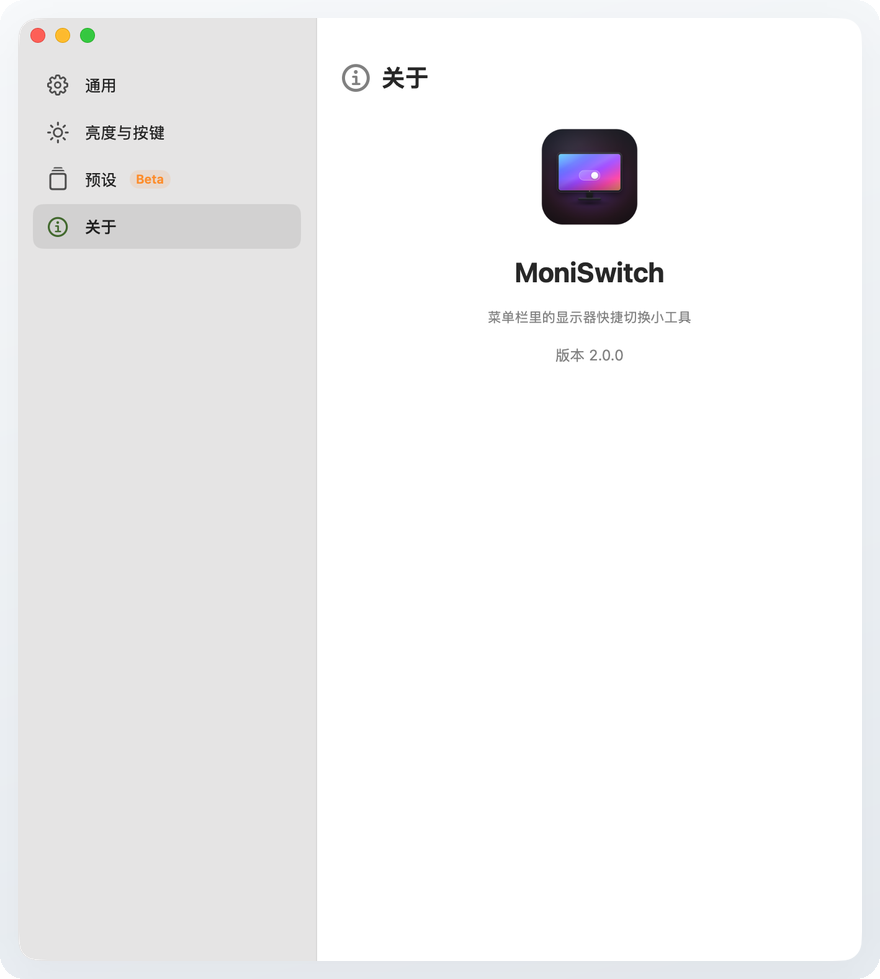
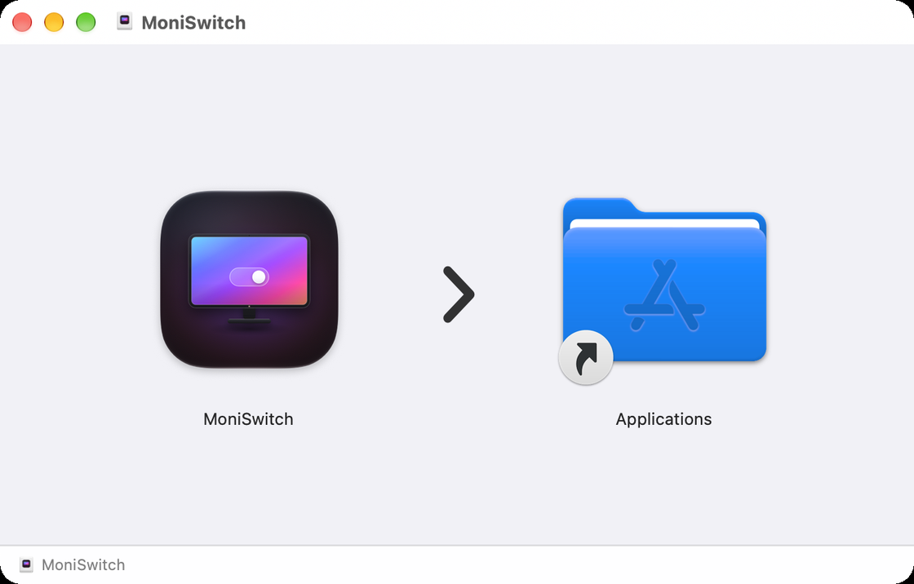

<p align="center">
  <a href="docs/poster.svg?v=2">
    
  </a>
</p>

<div align="center">

# MoniSwitch

**macOS 菜单栏里的显示器控制中心。**

切换主屏、排列与镜像外接屏、一键恢复整套布局，还能直接调外接显示器亮度——原生 DDC/CI、F1/F2 亮度键，不需要后台亮度辅助进程。

[English](README.md) · 简体中文 · [官网](https://m1688-cpu.github.io/MoniSwitch/)

<p align="center">
  <a href="https://github.com/M1688-cpu/MoniSwitch/releases/latest"></a>
  <a href="https://github.com/M1688-cpu/MoniSwitch#系统要求"></a>
  <a href="https://github.com/M1688-cpu/MoniSwitch#系统要求"></a>
  <a href="LICENSE"></a>
</p>

<a href="https://github.com/M1688-cpu/MoniSwitch/releases/latest/download/MoniSwitch.dmg"></a>

[功能](#功能) · [截图](#截图) · [安装](#安装) · [使用](#使用) · [常见问题](#常见问题)

</div>

---

MoniSwitch 常驻菜单栏，点开是一块悬浮的气泡卡片面板，而不是系统菜单。每块屏按真实比例画在布局图里，常用操作一到两次点击就能完成；面板高度随内容自适应，没有内部滚动条，也不用反复打开「系统设置 → 显示器」。

**v2.0 是一次面板层面的重写**，同时补上了显示器使用中另一半高频需求：外接屏亮度。每块支持 DDC/CI 的外接屏在面板顶部都有一条滑条，F1/F2 亮度键会调节鼠标所在屏的 DDC 亮度，七组低饱和主题让整块面板在浅色与深色下都能换色。

## v2.0 新增

- **原生外接屏亮度。** 每块外接屏一条 DDC/CI 滑条，在 Apple Silicon 上走私有 `IOAVService` 的 I2C 通路——与 MonitorControl、m1ddc 同一条路线。没有内核扩展、没有后台 DDC 辅助进程，也不需要 `ddcctl`。
- **F1/F2 跟着鼠标走。** active `CGEventTap` 监听亮度键，调节鼠标所在屏的 DDC 亮度；内置屏与不支持 DDC 的屏保持系统原生响应。按住 `⌥` 一次调节全部外接屏，并显示小气泡 HUD。
- **全新的面板壳，不是换皮。** 弃用 `NSPopover`，改为 MoniSwitch 自有的无边框 `NSPanel`：顶边锚在菜单栏图标下方，淡入并从顶部缩放展开，点面板外任意位置收起。
- **控制中心式布局。** 亮度卡常驻顶部，按真实比例绘制的布局图是枢纽；点击屏块，在第二张气泡卡里展开该屏参数。预设卡与底部工具栏顺次排在下面。
- **七组主题 + 跟随系统。** 鼠尾草绿、玫瑰红、橙、棕褐、蓝、蓝灰、青灰；每组派生卡底、高亮和实心强调三档色，并分别计算浅色与深色版本。
- **重做的设置窗口。** 原生边栏材质、分组卡片，并新增「亮度与按键」页：F1/F2 监听开关、辅助功能权限状态、DDC 兼容性说明都在这里。

## 功能

| 模块 | 你能做什么 |
| --- | --- |
| **显示器** | 选主屏、把外接屏放左/右、扩展或镜像、一键横排、切换分辨率与刷新率。 |
| **亮度** | 外接屏原生 DDC/CI 滑条、F1/F2 调鼠标所在屏、迷你 HUD，并按 EDID 身份记住每块屏的值。 |
| **预设** | 把整套布局（主屏、位置、镜像）存成预设，一键或一个全局快捷键恢复。 |
| **面板** | 无边框悬浮面板、按真实比例布局图、可折叠参数组、弹簧动画与悬停浮起。 |
| **设置** | 中英双语、登录时启动、自动刷新、通知、主题、预设与权限，集中在一个窗口。 |

### 每块屏，都只要一两次点击

- **点屏块，控那块屏。** 布局图就是枢纽：点一下屏块，展开它的参数气泡；再点一下收起。同一时间只展开一块屏，面板高度不会来回跳。
- **设为主屏** 把菜单栏和 Dock 移到你选的那块屏，并保持其余显示器的左右关系。
- **位置** 是左/右分段控件；**分辨率** 与 **刷新率** 在行内展开选项列表。HiDPI 变体会明确标注，重选分辨率不会再让 4K 屏掉进非缩放模式、出现「图标变小」。
- **镜像 / 扩展** 是非主屏参数气泡底部的两个图标按钮。面板会标出镜像目标屏，悬停按钮有通俗的 tooltip 说明。
- **一键自动排列** 把所有屏横向排开、消除重叠，并保持镜像组完整。
- **预设** 保存完整配置。与当前布局一致的预设自动带「当前」角标；判断依据是分辨率、刷新率、位置和镜像态，而不是易变的屏幕 ID。重插拔后 persistent ID 变了，会按分辨率和屏数重映射，而不是静默失效。
- **全局快捷键** 给每个预设绑定一个 Carbon `RegisterEventHotKey` 快捷键，不需要辅助功能权限。

### 亮度跟着你走

- **Apple Silicon 原生 DDC/CI。** DDC 栈通过私有 `IOAVService` API 直接与显示器的 I2C 控制通道通信，运行时用 `dlopen`/`dlsym` 解析符号，符号缺失时优雅降级。
- **每块外接屏一条滑条。** 自动发现支持 DDC 的外接屏，把 `CGDirectDisplayID` 映射到对应的 `IOAVService`；亮度值按 EDID UUID 持久化，拔插后不会重置。
- **F1/F2 对准鼠标所在屏。** 裸按 F1/F2 调节鼠标下的 DDC 外接屏；只有可控制的外接屏会吞掉事件，其余屏原样放行，内置屏继续走系统原生亮度与 OSD。按住 `⌥` 再按 F1/F2，可一次调节全部外接屏。
- **HUD 不打扰。** 小气泡出现在菜单栏图标下方，按住键时续期，松开后 1.2 秒淡出。
- **DDC 兼容性说清楚。** 经部分扩展坞、转接器或电视连接的屏幕不暴露 DDC 亮度；这类屏不会出现在亮度列表中，设置页会直接解释原因，而不是给一条调不动的滑条。

### 一块像原生菜单的面板

- 面板是 MoniSwitch 自有的**无边框 `NSPanel`**，直接锚在菜单栏图标下方。入场时淡入并从顶部缩放，点面板外任意位置（包括其他菜单栏图标）即收起。
- **高度跟随内容。** 面板级没有 `ScrollView`；展开参数组或切换语言时，面板以弹簧动画变高，而不是长出滚动条。
- **悬停有重量。** 卡片悬停时以底边为锚做 2D 仿射放大并轻微上浮，指针不会落入「进入→底边越过指针→退出→再进入」的振荡死区。底部工具栏按钮悬停时轮廓局部隆起。
- **长操作可见。** 切换进行中顶部浮现流动进度条，并禁用重复点击；失败会发系统通知。
- **布局图是活的。** 按真实比例绘制；悬停显示器行时对应屏块高亮，选中的屏块带勾选标记。
- **双语是设计的一部分。** English / 简体中文一键切换并持久保存；默认跟随系统强调色，也可以换成七组内置主题。

### 设置窗口，去繁就简

- **通用** —— 界面语言、登录时启动、主题色、自动刷新（含间隔）、菜单中的刷新率/HiDPI 标注、切换后通知。
- **亮度与按键** —— F1/F2 监听开关、辅助功能权限状态与跳转、DDC 兼容性说明。
- **预设（Beta）** —— 保存当前布局、应用/删除预设、录制或清除全局快捷键。
- **关于** —— 图标、版本和一句话简介。

## 截图

> 界面语言一键切换（English / 简体中文）。下列截图以中文界面为准；[英文 README](README.md) 有对应英文截图。

<table>
  <tr>
    <td width="50%" align="center" valign="middle">
      
      <br><b>面板全貌</b>
      <br><sub>亮度卡常驻顶部，中间是按真实比例绘制的布局图，下面是预设和底部工具栏。</sub>
    </td>
    <td width="50%" align="center" valign="middle">
      
      <br><b>展开显示器参数</b>
      <br><sub>点击屏块展开位置、分辨率、刷新率、设为主屏和镜像/扩展。</sub>
    </td>
  </tr>
  <tr>
    <td width="50%" align="center" valign="top">
      
      <br><b>设置 · 通用</b>
      <br><sub>语言、登录时启动、七组主题、刷新与通知，收在原生设置布局里。</sub>
    </td>
    <td width="50%" align="center" valign="top">
      
      <br><b>设置 · 预设</b>
      <br><sub>保存当前布局，应用或删除预设，每个预设绑定一个全局快捷键。</sub>
    </td>
  </tr>
</table>

<details>
<summary><b>更多截图</b> —— 亮度与按键、关于</summary>

<table>
  <tr>
    <td width="50%" align="center" valign="top">
      
      <br><b>设置 · 亮度与按键</b>
      <br><sub>F1/F2 监听、所需权限和 DDC 兼容性说明放在同一页。截图是未授权状态，App 会提供直达系统设置的入口。</sub>
    </td>
    <td width="50%" align="center" valign="top">
      
      <br><b>设置 · 关于</b>
      <br><sub>应用图标、简介和当前版本。</sub>
    </td>
  </tr>
</table>

</details>

## 安装

### 下载 DMG

<p align="center">
  
  <br><sub>打开 DMG，把 MoniSwitch 拖进 Applications。</sub>
</p>

1. 前往 Releases 下载最新的 [`MoniSwitch.dmg`](https://github.com/M1688-cpu/MoniSwitch/releases/latest/download/MoniSwitch.dmg)。
2. 打开 DMG，把 **MoniSwitch** 拖进 **Applications**。
3. 首次打开时，macOS 可能提示「来自身份不明的开发者」。MoniSwitch 没有 Apple 公证（见下方[说明](#关于未公证提示)），到 **系统设置 → 隐私与安全性 → 仍要打开** 放行一次即可，之后不会再提示。

> [!TIP]
> 这是纯菜单栏 App：启动后没有 Dock 图标，也没有主窗口。请到菜单栏找显示器图标；图标被其他菜单栏项目挤住时，按住 ⌘ 拖动即可调整位置。

### 自行编译

需要 macOS 14 或更高、Xcode / Swift 6 工具链，以及 `displayplacer` 二进制。`displayplacer` 不入库，获取方式见 [`Resources/README.md`](Resources/README.md)。

```bash
# 1. 克隆仓库
git clone https://github.com/M1688-cpu/MoniSwitch.git
cd MoniSwitch

# 2. 放置 displayplacer（见 Resources/README.md）
cp /path/to/displayplacer-apple-v140 ./Resources/displayplacer
chmod +x ./Resources/displayplacer

# 3. 一键编译、组装 .app、签名并生成 DMG
bash Support/build-app.sh

# 产物：
#   Support/MoniSwitch.app
#   Support/MoniSwitch.dmg
```

跑单元测试：

```bash
bash Support/run-tests.sh
```

项目是纯 Swift Package Manager，没有 `.xcodeproj`。打包脚本会自动挑选本机可用的最新 macOS SDK（装了 Xcode 时用其 27.0 SDK，否则用命令行工具里最新的 SDK）。

## 使用

1. 启动 MoniSwitch，点击菜单栏里的显示器图标。
2. 面板顶部是每块支持 DDC 的外接屏亮度条，中间是按真实比例绘制的布局图，下面是预设。
3. 点击屏块展开该屏参数：
   - **位置** —— 放到主屏左边或右边。
   - **分辨率 / 刷新率** —— 点整行展开选项列表；HiDPI 变体会标注。
   - **设为主屏** —— 把菜单栏和 Dock 移到这块屏。
   - **镜像 / 扩展** —— 非主屏参数气泡底部的两个图标按钮；悬停有说明。
4. 用顶部亮度条，或直接按 F1/F2：裸按调节鼠标所在屏，按住 `⌥` 调节全部外接屏。
5. 点 **预设** 恢复保存的布局；与当前布局一致的预设带「当前」角标。
6. 点面板外任意位置收起面板。齿轮按钮打开设置，电源按钮退出 App。

## 系统要求

- **macOS 14 Sonoma 或更高。**
- **Apple Silicon。** 当前发布的是 arm64 构建；Intel 支持在路线图中。
- **支持 DDC/CI 的外接显示器** 才能使用亮度功能。部分 USB-C 扩展坞、转接器和电视不暴露 DDC 亮度；这类屏会被跳过，而不是显示一条调不动的滑条。
- **辅助功能权限**（可选，仅 F1/F2 监听需要）。不授权时，滑条和预设照常工作，只有亮度键监听不生效。

## 权限与隐私

MoniSwitch 不接分析、不埋点、不访问网络服务。显示器切换走随包分发的 `displayplacer`，亮度走本地 DDC/CI 通道，预设和设置在 `UserDefaults` 里。

唯一可能申请的隐私权限是 **辅助功能**，用于 active 的 F1/F2 `CGEventTap`。切换后通知默认关闭；打开时 macOS 还会申请通知权限。只有当鼠标位于可 DDC 控制的外接屏上时，这个 tap 才会吞掉媒体键事件；其余情况事件原样放行。不想授权的话，在 **设置 → 亮度与按键** 里关掉 F1/F2 监听即可，其他功能不受影响。

## 关于未公证提示

MoniSwitch 采用 DMG 直链分发，不走 Mac App Store，因此没有 Apple 公证。这在开源免费工具里很常见，代码完全开源可审查。首次打开时到 **系统设置 → 隐私与安全性 → 仍要打开** 放行一次，macOS 会记住这个选择。

## 工作原理

MoniSwitch 是一个 SwiftUI + AppKit 的菜单栏 App，核心能力分成三块本地实现：

- **排列** —— [displayplacer](https://github.com/jakehilborn/displayplacer)（MIT，© Jake Hilborn）的图形界面。切换主屏时把目标屏的 `origin` 移到 `(0,0)`，其余屏按相同向量平移；镜像使用 displayplacer 的 `id:A+B` 语法；自动排列把所有屏横向排开，同时保持镜像组合并。
- **亮度** —— Apple Silicon 上的原生 DDC/CI 引擎。运行时解析私有 `IOAVService` 符号，为每块外接屏找到对应的 service，再通过串行 `actor` 写入 `[0x84, 0x03, 0x10, hi, lo, checksum]` 包；写请求会合并，并在 service 释放前做生命周期守卫。协议向量和解析行为都有测试覆盖。
- **按键** —— F1/F2 的 active `CGEventTap`。读取媒体键事件后按鼠标位置定位目标屏，对可控制的外接屏写 DDC 亮度；内置屏与不支持 DDC 的屏收到的是原样事件。它需要辅助功能权限，而不是输入监控。

面板本身是一块无边框 `NSPanel`，`sizingOptions = []`，SwiftUI 根视图钉在顶部，高度桥把内容实测高度写回窗口。这样面板才能随内容平滑长高/收起，而内容不会垂直漂移。

## 技术栈

- **语言：** Swift 6（语言模式 v5），SwiftUI + AppKit
- **最低系统：** macOS 14
- **构建：** Swift Package Manager，纯文本 `Package.swift`，无 Xcode 工程
- **测试：** Swift Testing（DDC 协议向量、displayplacer 解析 fixture、预设漂移重映射、面板主题派生）
- **分发：** 非沙盒，本地 ad-hoc 签名，DMG 直链
- **亮度：** 私有 `IOAVService`，经 `dlopen`/`dlsym` 运行时解析，Apple Silicon；F1/F2 走 active `CGEventTap`（辅助功能权限）
- **图标：** SVG 源在 `design/icon-web/`，导出到 `Resources/AppIcon-source.png` 与 `AppIcon.icns`

## 项目结构

```
MoniSwitch/
├── Package.swift                  # SPM 构建配置
├── Sources/MoniSwitch/
│   ├── MoniSwitchApp.swift        # @main 入口（菜单栏图标 + ⌘, 命令）
│   ├── PanelController.swift      # NSStatusItem + 无边框 NSPanel 面板壳
│   ├── AppState.swift             # 显示器列表 + 切换操作
│   ├── PanelView.swift            # 气泡卡片面板（亮度、布局枢纽、预设、工具栏）
│   ├── PanelTheme.swift           # 七组三档主题 + 浅深派生
│   ├── Components.swift           # 共享卡片/按钮/胶囊/悬停与布光修饰器
│   ├── BubbleMetrics.swift        # 设计令牌（圆角、字号、间距、阴影）
│   ├── Models.swift               # 显示器、分辨率、快捷键与预设模型
│   ├── ShellRunner.swift          # displayplacer 调用封装
│   ├── DisplayManager.swift       # 解析、切换、镜像组、自动排列、漂移重映射
│   ├── AppSettings.swift          # 偏好（登录启动、刷新、通知、主题）
│   ├── PresetManager.swift        # 布局预设（保存/应用/删除/快捷键）
│   ├── HotkeyManager.swift        # Carbon RegisterEventHotKey
│   ├── DockPolicyManager.swift    # 设置窗口宿主
│   ├── SettingsView.swift         # 设置窗口骨架（边栏 + 原生材质）
│   ├── SettingsTabs.swift         # 通用 / 亮度与按键 / 预设 / 关于
│   ├── Localization.swift         # 中英双语（L10n + TextKey）
│   ├── PrivateAPI.swift           # IOAVService + CoreDisplay 的 dlopen/dlsym 桥
│   ├── DDC.swift                  # DDC/CI 包构造、校验和与回复解析
│   ├── DDCDiscovery.swift         # 外接屏 → IOAVService 映射
│   ├── DDCWriter.swift            # 串行 DDC I/O actor、合并写与生命周期守卫
│   ├── BrightnessManager.swift    # 亮度中枢（发现、持久化、滑条、步进）
│   ├── BrightnessKeyTap.swift     # active F1/F2 CGEventTap（按鼠标所在屏）
│   └── BrightnessHUD.swift        # 菜单栏图标下方的迷你亮度气泡
├── Tests/MoniSwitchTests/         # Swift Testing 测试套件
├── Resources/                     # 随包 displayplacer、AppIcon.icns、图标源
├── Support/                       # Info.plist、build-app.sh、run-tests.sh
├── design/icon-web/               # 图标 SVG、预览页与 PNG 导出
├── docs/poster.svg                # README 顶部海报（SVG 源）
├── screenshots/                   # README 截图（en/zh 两套，文件名一一对应）
├── README.md                      # 英文 README
├── README.zh-CN.md                # 简体中文 README（本文件）
└── GITHUB_GUIDE.md                # 维护者的 GitHub 操作手册
```

## 路线图

- [x] 显示器列表与切换主屏
- [x] 外接屏左/右移动
- [x] 扩展 / 镜像切换
- [x] 中英双语界面
- [x] 登录时启动、自动刷新、切换通知
- [x] 布局预设与每预设全局快捷键
- [x] 面板内切换分辨率与刷新率
- [x] HiDPI 保真切换
- [x] 按真实比例的可交互布局预览
- [x] 一键自动排列（镜像组感知）
- [x] 预设 ID 漂移重映射与「当前」角标
- [x] 无边框悬浮面板、弹簧揭示与点外部收起
- [x] **v2：** 原生 DDC/CI 外接屏亮度、F1/F2 监听与 HUD
- [x] **v2：** 七组主题与浅深派生
- [x] **v2：** 重做设置窗口，新增「亮度与按键」页
- [ ] 适配 Intel
- [ ] 三块以上显示器场景的打磨与测试
- [ ] Apple 公证

## 常见问题

<details>
<summary><b>支持 Intel Mac 吗？</b></summary>

暂不支持。当前版本是 Apple Silicon（arm64）构建，Intel 支持在路线图中；主要待补的是 DDC 发现链路。
</details>

<details>
<summary><b>为什么 macOS 提示「身份不明的开发者」？</b></summary>

App 采用 DMG 直链分发，没有走 Mac App Store，也没有 Apple 公证。代码完全开源。到 **系统设置 → 隐私与安全性 → 仍要打开** 放行一次即可，详见[上方说明](#关于未公证提示)。
</details>

<details>
<summary><b>为什么外接屏没有出现在亮度列表里？</b></summary>

DDC/CI 必须能到达显示器。部分 USB-C 扩展坞、转接器、KVM 和电视不透传 DDC 通道，这类屏会被跳过，而不是给一条调不动的滑条。可以试试直连线缆或换一个转接器/端口。设置窗口的「亮度与按键」页也有同样的说明。
</details>

<details>
<summary><b>需要自己安装 displayplacer 吗？</b></summary>

不需要。发布版 App 已随包携带 `displayplacer`。只有自行编译时才需要按 [`Resources/README.md`](Resources/README.md) 放置。
</details>

<details>
<summary><b>F1/F2 还会调内置屏吗？</b></summary>

鼠标在可 DDC 控制的外接屏上时，MoniSwitch 会吞掉 F1/F2 并直接调节那块屏的 DDC 亮度；其余情况事件原样放行，所以内置屏保持系统原生响应。按住 `⌥` 再按 F1/F2，可一次调节全部外接屏。
</details>

<details>
<summary><b>预设能在重插拔后继续用吗？</b></summary>

通常可以。macOS 改变 persistent ID 时，MoniSwitch 会按分辨率和屏数重映射保存的参数；如果无法完整、无歧义地映射，会保留原预设，而不是错误地套到别的屏上。
</details>

<details>
<summary><b>App 会把数据传到网上吗？</b></summary>

不会。没有分析、埋点或账号系统；显示与亮度都在本地完成，预设和偏好保存在 `UserDefaults`。
</details>

## 参与贡献

欢迎提交 Issue 和 Pull Request。如果改动了界面，请同步重截 `screenshots/en` 与 `screenshots/zh` 下受影响的截图，保证两个 README 一致。提交 PR 前建议先跑：

```bash
bash Support/run-tests.sh
bash Support/build-app.sh
```

## License

MIT License。MoniSwitch 代码 © MoniSwitch contributors。
随包分发的 [displayplacer](https://github.com/jakehilborn/displayplacer) © Jake Hilborn，同样为 MIT License。

## 致谢

- [displayplacer](https://github.com/jakehilborn/displayplacer) —— 显示器排列功能背后的配置引擎。
- [MonitorControl](https://github.com/MonitorControl/MonitorControl) 与 [m1ddc](https://github.com/waydabber/m1ddc) —— 均为 MIT；它们的 DDC/CI 常量、校验和与屏→服务映射为亮度引擎提供了重要参考。MoniSwitch 是独立实现，不是 fork。
- 图标极光配色与面板三档主题均为自研；SVG 源在 [`design/icon-web/`](design/icon-web/) 和 [`docs/poster.svg`](docs/poster.svg)。
